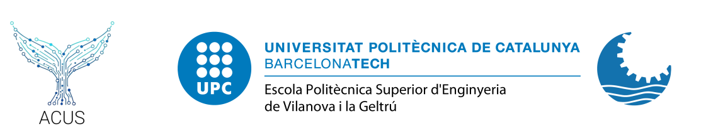

# ACUS — Exploració, Acústica Marina i Sistemes de Sonar

---

**Course**: ACUS - Exploració, Acústica Marina i Sistemes de Sonar  
**Program**: Ciències i Tecnologies del Mar (CiTM)  
**University**: Universitat Politècnica de Catalunya (UPC)  
**Author**: Enoc Martínez  
**Department**: Departament d'Enginyeria (EEL)  
**Contact**: enoc.martinez@upc.edu  

  

---

## About the course

ACUS introduces the physics of underwater sound and the tools used to record, process and analyse it. The course is divided into **12 theory lectures** (full group) and **6 laboratory sessions** (split group).

Across the course you will work with:

- **Underwater acoustics principles** — vibrations, waves, sound propagation, sound sources (physical, biological, anthropogenic), the SOFAR channel, and logarithms.
- **Hydrophones and acquisition** — analog vs digital, the acquisition chain, and computing pressure from a WAV recording.
- **Audio files** — working in the time and frequency domains.
- **Signal processing** — Fourier transform, FFT, spectrograms, filters.
- **Sound statistics** — Sound Pressure Level (SPL), Sound Exposure Level (SEL), and third-octave bands.
- **Bioacoustics and detection** — marine mammal sounds, K-means clustering, and detecting features in spectrograms.
- **Active acoustics** — acoustic tags, ADCPs, and echo sounders.

Open a lab folder, read its `L0X.md` file, and work through the tasks in order. Exercises are designed to be completed in Python 3 — no prior programming experience is assumed beyond the very basics.

## License

Released under the MIT License. See [LICENSE](LICENSE).
